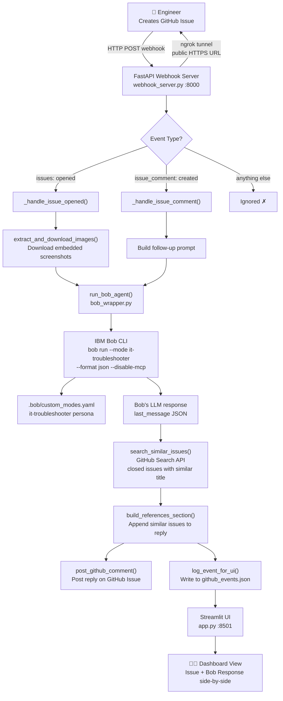

# 🐙 bob_squad — GitHub Issue → IBM Bob AI Automated IT Troubleshooter

> **Zero-touch IT incident triage.** When an engineer files a GitHub Issue describing an infrastructure problem, `bob_squad` automatically analyzes it with IBM Bob Shell and posts a structured expert troubleshooting response back as a comment — no human intervention required.

---

## 📋 Table of Contents

- [What It Does](#-what-it-does)
- [Architecture](#-architecture)
- [Project Structure](#-project-structure)
- [Prerequisites](#-prerequisites)
- [Installation](#-installation)
- [Configuration](#-configuration)
- [Running the Project](#-running-the-project)
- [GitHub Webhook Setup](#-github-webhook-setup)
- [How It Works — Step by Step](#-how-it-works--step-by-step)
- [IT Troubleshooter Mode](#-it-troubleshooter-mode)
- [Streamlit Dashboard](#-streamlit-dashboard)
- [Real Usage Stats](#-real-usage-stats)
- [API Reference](#-api-reference)
- [Environment Variables](#-environment-variables)
- [Dependencies](#-dependencies)
- [FAQ](#-faq)

---

## ✨ What It Does

`bob_squad` is a fully automated IT operations pipeline that bridges **GitHub Issues** with **IBM Bob Shell** (an AI-powered CLI agent):

1. An engineer opens a GitHub Issue describing an IT infrastructure problem (e.g., NSX certificate expiry, ESXi host PSOD, disconnected vCenter host).
2. GitHub sends a webhook `POST` to the FastAPI server.
3. The server feeds the issue title, description, and any embedded screenshots to IBM Bob Shell.
4. Bob's `it-troubleshooter` mode responds as a **senior on-call infrastructure engineer** with:
   - Ranked root causes
   - Exact diagnostic CLI commands
   - Per-cause resolution steps
   - Preventive measures
   - Real vendor KB/doc links (VMware, Microsoft, Red Hat, Cisco, etc.)
5. The structured response is posted back as a **GitHub comment** automatically.
6. Follow-up comments from users trigger additional Bob responses (with bot-loop prevention).
7. All events are logged and displayed in a live **Streamlit dashboard** with ROI metrics.

**Typical response time: ~21–29 seconds. Typical cost per issue: ~$0.0074–$0.0087.**

---

## 🏗 Architecture



---

## 📁 Project Structure

```
bob_squad/
├── app.py                    # Streamlit dashboard — live issue + AI response viewer
├── webhook_server.py         # FastAPI server — receives GitHub webhooks, runs the pipeline
├── bob_wrapper.py            # IBM Bob CLI wrapper — shells out to `bob run`, parses JSON
├── start.bat                 # One-click launcher — starts all 3 services in separate windows
├── requirements.txt          # Python dependencies
├── .env.example              # Template for required environment variables
├── github_events.json        # Rolling log (last 20 events) — shared by server and UI
└── .bob/
    └── custom_modes.yaml     # Defines the `it-troubleshooter` Bob mode & persona
```

| File | Role |
|---|---|
| `start.bat` | Launcher — opens 3 terminal windows: webhook server, ngrok tunnel, Streamlit UI |
| `webhook_server.py` | FastAPI server — receives GitHub webhooks, orchestrates the full pipeline |
| `bob_wrapper.py` | IBM Bob CLI wrapper — builds and runs `bob run ...` as a subprocess, parses JSON output |
| `app.py` | Streamlit dashboard — reads `github_events.json` and renders each issue + Bob's response |
| `.bob/custom_modes.yaml` | Defines the `it-troubleshooter` Bob mode with structured IT response format |
| `github_events.json` | Rolling log (last 20 events) — shared state between webhook server and UI |

---

## ✅ Prerequisites

Before you start, make sure you have:

| Requirement | Version | Notes |
|---|---|---|
| Python | 3.10+ | For the FastAPI server and Streamlit UI |
| Node.js + npm | 18+ | Required to install IBM Bob CLI |
| IBM Bob CLI | Latest | `npm install -g @ibm/bob` |
| ngrok | Any | Exposes local port 8000 to a public HTTPS URL for GitHub webhooks |
| IBM Bob API key | — | Obtained from [IBM Bob](https://www.ibm.com/products/bob) |
| GitHub Personal Access Token | — | Scopes: `repo` (read issues, post comments, search) |

---

## 🛠 Installation

### 1. Clone the repository

```bash
git clone https://github.com/<your-org>/bob_squad.git
cd bob_squad
```

### 2. Create and activate a virtual environment

```bash
# Windows
python -m venv .venv
.venv\Scripts\activate

# macOS / Linux
python -m venv .venv
source .venv/bin/activate
```

### 3. Install Python dependencies

```bash
pip install -r requirements.txt
```

### 4. Install IBM Bob CLI globally

```bash
npm install -g @ibm/bob
```

Verify the installation:

```bash
bob --version
```

### 5. Install ngrok

Download from [ngrok.com](https://ngrok.com/download) and add it to your `PATH`, or install via:

```bash
# macOS (Homebrew)
brew install ngrok

# Windows (Chocolatey)
choco install ngrok
```

---

## ⚙️ Configuration

### 1. Set up environment variables

Copy `.env.example` to `.env` and fill in your credentials:

```bash
cp .env.example .env
```

```env
# IBM Bob Shell API key
BOB_API_KEY=your_bob_api_key_here

# GitHub personal access token (scopes: repo)
GITHUB_TOKEN=your_github_token_here
```

> ⚠️ **Never commit `.env` to version control.** It is already listed in `.gitignore`.

### 2. Authenticate ngrok (first time only)

```bash
ngrok config add-authtoken <YOUR_NGROK_AUTHTOKEN>
```

---

## 🚀 Running the Project

### Option A — One-click launcher (Windows)

Double-click `start.bat` or run it from a terminal:

```cmd
start.bat
```

This opens **three separate terminal windows**:

| Window | Service | URL |
|---|---|---|
| `bob_squad \| webhook :8000` | FastAPI webhook server (uvicorn) | `http://127.0.0.1:8000` |
| `bob_squad \| ngrok` | ngrok tunnel (public HTTPS) | See ngrok window for `https://*.ngrok-free.app` |
| `bob_squad \| streamlit :8501` | Streamlit dashboard | `http://localhost:8501` |

### Option B — Manual startup

Open three separate terminals and run each command:

```bash
# Terminal 1 — Webhook server
.venv/Scripts/uvicorn webhook_server:app --port 8000

# Terminal 2 — ngrok tunnel
ngrok http 8000

# Terminal 3 — Streamlit dashboard
.venv/Scripts/streamlit run app.py --server.port 8501
```

---

## 🔗 GitHub Webhook Setup

After starting ngrok, copy the public HTTPS URL from the ngrok terminal (e.g., `https://abc123.ngrok-free.app`).

1. Go to your GitHub repository → **Settings** → **Webhooks** → **Add webhook**
2. Set the fields:

   | Field | Value |
   |---|---|
   | Payload URL | `https://abc123.ngrok-free.app/webhook/github` |
   | Content type | `application/json` |
   | Secret | _(leave blank or add a secret — currently not validated)_ |
   | Events | Select **"Let me select individual events"** → check **Issues** and **Issue comments** |
   | Active | ✅ Checked |

3. Click **Add webhook**. GitHub will send a `ping` event — the server will silently ignore it.

> **Note:** The ngrok URL changes each time you restart ngrok on a free plan. Update the GitHub webhook URL whenever you restart.

---

## 🔄 How It Works — Step by Step

### 1. 🚀 Startup (`start.bat`)

Three processes start in parallel. At startup, the webhook server resolves the **bot's own GitHub login** via `GET /api/v1/user` to prevent infinite reply loops when it posts comments.

### 2. 📨 GitHub Webhook Received (`webhook_server.py`)

GitHub sends `POST /webhook/github` for two event types:

| Event | Action | Handler |
|---|---|---|
| `issues` | `opened` | `_handle_issue_opened()` |
| `issue_comment` | `created` | `_handle_issue_comment()` |
| _(anything else)_ | — | Silently ignored |

Bot-loop prevention: if `sender.login == _BOT_LOGIN`, the comment is immediately ignored and no Bob invocation occurs.

### 3. 🖼️ Screenshot Extraction (`webhook_server.py`)

`extract_and_download_images()` scans the issue body for embedded GitHub image markdown (``), downloads each image to a temporary directory, and passes the local paths in the Bob prompt so Bob can reference them.

### 4. 🤖 IBM Bob Invocation (`bob_wrapper.py`)

`run_bob_agent()` shells out to the IBM Bob CLI:

```bash
bob run \
  --format json \
  --mode it-troubleshooter \
  --workspace <SCREENSHOTS_DIR> \
  --max-turns 5 \
  --disable-mcp \
  --disable-tool-groups read,edit,execute,mcp \
  --trust --accept-license \
  "<GitHub Issue prompt>"
```

| Flag | Purpose |
|---|---|
| `--mode it-troubleshooter` | Activates the custom persona from `.bob/custom_modes.yaml` |
| `--disable-mcp --disable-tool-groups read,edit,execute,mcp` | Bob is **knowledge-only** — no file/code access, pure LLM reasoning |
| `--format json` | Parses `last_message` from structured JSON output |
| `--max-turns 5` | Caps the number of LLM reasoning turns to control cost |
| `--resume <task_id>` | _(Optional)_ Resumes a prior conversation for follow-up comments |

### 5. 🔍 Similar Issue Search (`webhook_server.py`)

`search_similar_issues()` queries the GitHub Search API for **closed issues** in the same repository matching the first 6 words of the issue title. The top 3 results are appended to Bob's reply as a **"Similar Resolved Issues"** section.

### 6. 💬 GitHub Comment Posted (`webhook_server.py`)

`post_github_comment()` uses the GitHub REST API (`POST` to `issue.comments_url`) to post Bob's full structured markdown response directly on the original issue.

### 7. 📊 Dashboard Updated (`app.py`)

`log_event_for_ui()` appends the event record (issue metadata + Bob's response + cost/duration stats) to `github_events.json`, keeping only the last 20 events. The Streamlit dashboard reads this file and renders each incident in real time.

---

## 🧠 IT Troubleshooter Mode

Defined in [`.bob/custom_modes.yaml`](.bob/custom_modes.yaml), the `it-troubleshooter` mode configures Bob to behave as a **senior on-call infrastructure engineer**.

**Domain expertise:**
- Networking (NSX, VLANs, BGP, SSL/TLS)
- VMware / ESXi / vCenter / vSAN
- Linux & Windows Server
- Containerization (Docker, Kubernetes)
- Cloud platforms (AWS, Azure, GCP)
- Databases, CI/CD pipelines, monitoring, scripting

**Mandatory response structure:**

```
## Likely Root Causes
Ranked by probability.

## Immediate Diagnostic Steps
Numbered list with exact CLI commands, vSphere UI paths, or config checks.

## Resolution Steps
Per-cause specific fix with exact commands or configuration changes.

## Preventive Measures
Bullet list to prevent recurrence.

## References
3–5 real, publicly accessible KB/vendor doc links (VMware KB, Microsoft Docs,
Red Hat KB, Cisco TAC, AWS docs, etc.) — no fabricated URLs.
```

Bob is instructed to **never ask for clarification**, never reference the workspace or codebase, and answer directly from technical knowledge.

---

## 📊 Streamlit Dashboard

Access at `http://localhost:8501`.

**Sidebar controls:**
- 🔍 **Full-Text Search** — searches across issue title, body, and Bob's response
- **Quick Topic Filters** — one-click filter buttons for NSX, ESXi/PSOD, Certificates, Disconnected
- **Sort By** — Newest First, Oldest First, Highest Cost, Longest Duration
- 🔄 **Refresh** — manually reloads the data

**Metrics header (across all events):**
- Total Issues processed
- Total AI Cost (cumulative `$`)
- Avg. Response Time (seconds)
- Estimated Savings (assuming $25/issue manual triage cost)

**Performance charts:**
- Cost per Issue bar chart
- Response Time trend line chart

**Incident cards:**
Each issue renders in an expander with two columns:
- **Left** — issue number, GitHub link, description text, embedded screenshots
- **Right** — Bob's full structured troubleshooting markdown response

---

## 📈 Real Usage Stats

Issues processed in production, showing Bob's performance per invocation:

| Issue | Topic | Duration | Cost |
|---|---|---|---|
| #17 | NSX certificates expired | ~22s | $0.0087 |
| #16 | Failed to remove ESXi host | ~21s | $0.0075 |
| #15 | ESXi host PSOD error | ~29s | $0.0083 |
| #14 | NSX errors (with screenshot) | ~26s | $0.0077 |
| #13 | ESXi host disconnected state | ~21s | $0.0074 |

**Estimated savings** vs. manual L2 triage (~$25/issue): **~$124.96 for 5 issues.**

---

## 📡 API Reference

### `POST /webhook/github`

Receives GitHub webhook payloads.

**Headers:**
| Header | Value |
|---|---|
| `X-GitHub-Event` | `issues` or `issue_comment` |
| `Content-Type` | `application/json` |

**Handled events:**

| `X-GitHub-Event` | `action` | Behaviour |
|---|---|---|
| `issues` | `opened` | Runs Bob, posts comment, logs event |
| `issue_comment` | `created` | Runs Bob (unless sender is bot), posts comment, logs event |
| _(anything else)_ | _(any)_ | Returns `{"status": "ignored"}` |

**Response (success):**
```json
{ "status": "processed", "issue": 17 }
```

**Response (ignored):**
```json
{ "status": "ignored", "event": "push", "action": null }
```

---

## 🌍 Environment Variables

| Variable | Required | Description |
|---|---|---|
| `BOB_API_KEY` | ✅ Yes | IBM Bob Shell API key — used by the Bob CLI internally |
| `GITHUB_TOKEN` | ✅ Yes | GitHub PAT — used for posting comments, downloading images, searching issues. Required scopes: `repo` |

Both variables are loaded from `.env` automatically via `python-dotenv` on startup.

---

## 📦 Dependencies

**Python (`requirements.txt`):**

```
langchain
python-dotenv
streamlit
fastapi
uvicorn
requests
```

```bash
pip install -r requirements.txt
```

**Node.js (global):**

```bash
npm install -g @ibm/bob
```

---

## ❓ FAQ

**Q: The ngrok URL changes every restart. How do I make it permanent?**  
A: Upgrade to a paid ngrok plan to get a fixed domain, or use a self-hosted reverse proxy (Caddy, nginx) with a static domain.

**Q: Can Bob access the actual server/VM it's troubleshooting?**  
A: No — by design. The `--disable-mcp --disable-tool-groups read,edit,execute,mcp` flags restrict Bob to pure LLM knowledge reasoning. It has no shell access to any external systems.

**Q: What happens if Bob fails or times out?**  
A: `bob_wrapper.py` captures the non-zero exit code and returns a structured error dict. The webhook server will not post a GitHub comment in this case, but the event is still logged.

**Q: How do I prevent the bot from replying to itself in a loop?**  
A: At startup, the webhook server resolves the bot's GitHub username via `GET /api/github.com/user`. Any `issue_comment` event where `sender.login` matches the bot login is immediately ignored.

**Q: Can I use a different AI mode instead of `it-troubleshooter`?**  
A: Yes — edit `bob_wrapper.py`'s `run_bob_agent()` default `mode` parameter, or pass a different `mode` string when calling the function. Add new modes to `.bob/custom_modes.yaml`.

**Q: How do I add more topic filters to the dashboard?**  
A: Add `st.sidebar.checkbox()` calls in `app.py` and add corresponding `if filter_xxx` blocks in the filtering loop.

**Q: Where are screenshots stored?**  
A: In a system temp directory: `<TEMP>/bob_kb_workspace/`. Each image is named `issue_<number>_img_<index>.png`. They are not cleaned up automatically.

---

## 🤝 Contributing

1. Fork the repository
2. Create a feature branch (`git checkout -b feature/my-improvement`)
3. Commit your changes (`git commit -m 'Add: description'`)
4. Push to the branch (`git push origin feature/my-improvement`)
5. Open a Pull Request

---

## 📄 License

This project is provided as-is for demonstration and internal use. See your IBM Bob license terms for usage restrictions on the IBM Bob CLI.
